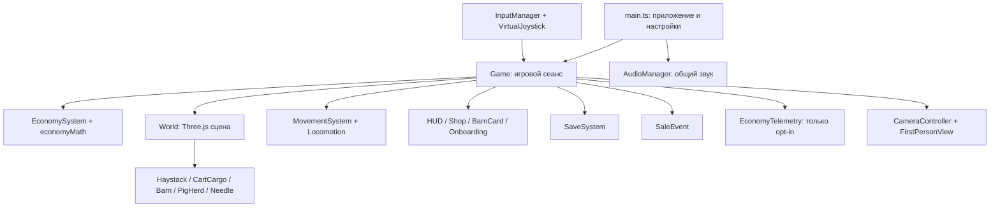

# Архитектура проекта и карта документации

Обновлено: **2026-11-16**. Краткий вход в проект для разработчика, тестировщика и Codex. Описывает текущий исходник; наличие системы не означает, что её последняя версия проверена на устройстве.

Главные источники: [AGENTS.md](AGENTS.md) — правила работы, [GAME_REQUIREMENTS.md](GAME_REQUIREMENTS.md) — поведение игры, [ART_DIRECTION.md](ART_DIRECTION.md) — визуальное направление. Этот обзор их поясняет, но не заменяет. При конфликте фиксируем расхождение и спрашиваем владельца о существенном продуктовом решении.

## 1. Что разрабатываем

- **Needle in a Haystack** — яркая ферма от первого лица, прежде всего для телефона; ПК тоже поддерживается.
- Цикл: собрать сено → отнести в телегу → мгновенно продать → купить улучшения → разобрать конечный стог → найти иголку.
- Стог содержит 20 000 отдельных игровых соломинок; поле 26×26. Сено сверху слева, повёрнутый амбар сверху справа, телега снизу слева.
- Одна иголка и прежняя победа сохранены по решению владельца. Коллекция нескольких иголок и престиж сейчас не входят в реализацию.
- Есть инструменты, рюкзак, три последовательные покупки свинок, редкости и событие ×2 только на сдачу сена игроком.
- Основная цель публикации — **itch.io HTML5**. Playground — отдельный хост для разработчиков/тестировщиков, а не игровой backend.

## 2. Стек и расположение файлов

**Three.js + TypeScript + Vite + HTML/CSS**, без React, тяжёлой физики и собственного сервера внутри игры. Все npm-команды выполняются из `needle-in-a-haystack/`.

```text
needle/                         # корень Git-репозитория
├── ARCHITECTURE.md              # этот обзор
├── AGENTS.md                   # рабочие правила
├── GAME_REQUIREMENTS.md         # игровые/технические требования и история
├── ART_DIRECTION.md             # стиль
├── ASSETS_*.md, AUDIO_ASSETS.md  # живые списки ассетов
├── ASSET_BUDGETS.md             # качество, размеры и память
├── ECONOMY_*.md, *.json         # действующий каталог и отдельные эксперименты
├── OPEN_QUESTIONS.md            # открытые и решённые вопросы
└── needle-in-a-haystack/
    ├── index.html, vite.config.ts, package.json
    ├── public/models/          # пользовательская текстурированная телега
    ├── public/audio/           # музыка и четыре эффекта владельца
    ├── src/
    │   ├── main.ts, style.css  # загрузка приложения и HTML-интерфейс
    │   ├── config/             # баланс, расположение, редкости, подача
    │   ├── core/               # Game, ввод, камера, звук, освобождение ресурсов
    │   ├── systems/            # экономика, движение, сохранения, события, замеры
    │   ├── entities/           # игрок и отдельная сцена рук/инструмента
    │   ├── world/              # мир, сено, телега, амбар, свинки, декор
    │   └── ui/                 # книга, карточка, HUD, обучение, SVG, RU/EN
    ├── scripts/                # экспорт каталога, симуляция, отдельные проверки
    ├── verification/           # исторические отчёты проверок/ограничения
    └── ASSET_LICENSES.md        # происхождение ассетов и лицензии
```

`dist/` — результат production-сборки, не источник изменений. Старые Vite-картинки в `src/assets/` не являются используемым игровым арт-набором.

## 3. Как связаны основные системы



Это карта главной координации, не обещание строгой независимости модулей. Например, `Haystack` использует декодирование из `SaveSystem`, витрина читает экономику, а UI обращается к существующим DOM-узлам. Сохраняем простую архитектуру; полный ECS/MVC-рефакторинг не требуется.

| Модуль | Ответственность |
|---|---|
| [main.ts](needle-in-a-haystack/src/main.ts) | Создаёт DOM и диалоги, читает настройки, запускает/перезапускает `Game`, меняет язык, подключает звук и пользовательские действия настроек |
| [Game.ts](needle-in-a-haystack/src/core/Game.ts) | Владеет игровым сеансом: цикл кадра, команды, дистанции, сбор/продажа/покупка, HUD, сохранение, пауза и победа |
| [InputManager.ts](needle-in-a-haystack/src/core/InputManager.ts), `VirtualJoystick.ts` | Pointer/клавиши, выбор цели, touch-обзор, джойстик, удержание только пылесоса, сброс ввода |
| `CameraController.ts` | PerspectiveCamera, направление взгляда, высота глаз, resize |
| [MovementSystem.ts](needle-in-a-haystack/src/systems/MovementSystem.ts), `Locomotion.ts` | Границы/препятствия, в том числе повёрнутые стены; прыжок, гравитация и опора на сено. Навигационный метод не возвращает автоподход по клику |
| [EconomySystem.ts](needle-in-a-haystack/src/systems/EconomySystem.ts), `economyMath.ts` | Ресурсы, монеты, уровни, порции, цены/эффекты, дробные выплаты и общие чистые формулы |
| [World.ts](needle-in-a-haystack/src/world/World.ts) | Собирает 3D-мир, pickables, освещение, объекты, загрузку необязательных ресурсов и визуальный результат действий |
| [Haystack.ts](needle-in-a-haystack/src/world/Haystack.ts) | Инстансированные соломинки со стабильными ID, колонки/опора, выбор, редкость, удаление и ограниченное осыпание/полёты |
| `CartCargo.ts`, `cartModel.ts` | Точный счётчик проданного сена и простая растущая куча; асинхронная GLB-модель с процедурным fallback |
| `Barn.ts`, `ToolAssets.ts`, `PigHerd.ts`, `Needle.ts`, `FarmDecor.ts` | Витрина/общие примитивы, свинки, иголка и необязательное статичное окружение |
| [FirstPersonView.ts](needle-in-a-haystack/src/entities/FirstPersonView.ts) | Отдельная камера/сцена рук или инструмента, поверх основной сцены в том же renderer; переносимое сено и анимации |
| [Shop.ts](needle-in-a-haystack/src/ui/Shop.ts), `BarnCard.ts` | Книга прокачки и отдельное подтверждение покупки/экипировки у предмета в амбаре |
| `HudFeedback.ts`, `FloatingFeedback.ts`, `icons.ts`, `i18n.ts` | Досчёт/пульс/декоративные монеты, четыре всплывающих сообщения, общие SVG и RU/EN |
| [Onboarding.ts](needle-in-a-haystack/src/ui/Onboarding.ts) | Неблокирующее обучение реальными действиями, указатель/подсветка, локальное завершение и повтор |
| [SaleEvent.ts](needle-in-a-haystack/src/systems/SaleEvent.ts) | Случайное ожидание и время ×2 по активному игровому времени; без офлайн-дохода и таймера срочности |
| [SaveSystem.ts](needle-in-a-haystack/src/systems/SaveSystem.ts) | Версионирование, проверка сохранений, настройки и обработка недоступного/повреждённого localStorage |
| [AudioManager.ts](needle-in-a-haystack/src/core/AudioManager.ts) | Один менеджер на приложение: музыка, шаги, ограниченный пул эффектов, настройки, жест пользователя и lifecycle |
| [EconomyTelemetry.ts](needle-in-a-haystack/src/systems/EconomyTelemetry.ts) | Только добровольные локальные агрегаты текущего сегмента сессии, JSON по кнопке; не backend-аналитика |

## 4. Что происходит при запуске и в кадре

1. `index.html` даёт начальный экран и надёжное подключение CSS; `main.ts` создаёт интерфейс, настройки и общий звук.
2. `Game` создаёт renderer, базовый мир/стог, восстанавливает допустимое сохранение, подключает ввод и интерфейс.
3. В активном кадре обрабатываются движение, удержание/завершение порции, событие, свинки и ограниченная физика сена. Позиция камеры/прицел обновляются, затем рисуются мир и отдельный вид рук/инструмента.
4. После первого готового кадра отложенно создаются витрина и декор, отдельно загружается текстурированная телега. До неё работает fallback. Модель инструмента в руках создаётся по выбору.
5. Меню, фон, потеря фокуса и технические ошибки останавливают соответствующую игровую работу/ввод. Большой dt после возврата ограничивается.
6. Перезапуск освобождает сеанс: listeners/observer/timer/анимации, геометрию, материалы, текстуры и renderer. Звук живёт на уровне приложения, без новой копии музыки на каждый `Game`.

Логика использует delta time. HUD имеет собственный ограниченный цикл только на время изменения чисел; декор статичен. `Game` уже крупный координатор — новые самостоятельные механизмы лучше добавлять модулем, а не очередным несвязанным блоком внутри кадра.

## 5. Главные инварианты поведения

- **ПК:** WASD/стрелки, обзор перетаскиванием мыши, E/клик для действия, Space для прыжка. **Телефон:** джойстик, независимый touch-обзор, касание/кнопка действия и прыжка. Земля не запускает маршрут, удалённый объект не включает автоподход.
- Один тык — одна порция, без очереди. Исключение — удерживаемый пылесос. Повтор при занятом сборе игнорируется **без звука отказа**. Отмена указателя/меню/фон сбрасывают удержание.
- Нужна дистанция взаимодействия. Точная выделенная соломинка собирается первой; ID не зависит от перестановки инстансов. Порция ограничена свободной сумкой и остатком сена.
- Ходьба отменяет обычный сбор; пылесосом можно работать на ходу. Есть прыжок и ходьба по поверхности, без 20 000 rigid bodies.
- С инструментом обе руки скрыты. Видимое количество переносимого сена следует инвентарю.
- Сдача — весь инвентарь и немедленная атомарная выплата. Куча в телеге статичная, растёт по счётчику, без отдельного меша на каждый проданный стебель.
- Покупка у амбара требует карточки/подтверждения; уже купленный инструмент только экипируется. Книга прокачивает персонажа/купленные предметы. Повторный клик не дублирует сделку.
- Свинки необязательны, максимум три. Они расходуют тот же конечный запас, их доход не создание нового сена. Их AI владелец пока просит не менять; скорость еды может упираться в прогулки/подход.
- Редкость платит один раз за фактический сбор. Бонус граблей, обычная продажа и ×2 имеют разные правила и учёт.
- ×2: после обучения, ожидание 180–300 активных секунд, 45 секунд бонуса, только сдача игроком. Меню/фон — пауза; доход свинок и редкие бонусы не удваиваются.
- Счётчики, частицы, звук и анимации только показывают результат; не выдают монеты и не задерживают запись состояния.

## 6. Конфигурация, экономика и сохранения

| Файл | Что менять здесь |
|---|---|
| [balance.ts](needle-in-a-haystack/src/config/balance.ts) | Действующий профиль, базовые параметры мира/игрока/сена, координаты, уровни и цены персонажа/инструментов |
| [progression.ts](needle-in-a-haystack/src/config/progression.ts) | Эффекты и ветки инструментов, цены/бафы свинок, локальные/мировые координаты амбара и повёрнутые стены |
| [rarity.ts](needle-in-a-haystack/src/config/rarity.ts) | Версия, seed, пороги/награды/символы редкости. Изменения требуют учёта уже собранных ID |
| [presentation.ts](needle-in-a-haystack/src/config/presentation.ts) | Общие длительности/easing/лимиты визуальных эффектов и параметры события |
| `legacyBalance.ts`, `legacyProgression.ts`, previous-функции цен | Исторические цены для проверки прежних расходов; нельзя «обновлять» их под новый баланс |
| [balance.v2.ts](needle-in-a-haystack/src/config/balance.v2.ts) | **Неактивные** исходный и переработанный кандидаты v2, не production-источник |

Не путать независимые версии: `economyVersion=1` — текущий профиль экономики; **SaveData v5** — формат игрового сохранения; ключ `needle.save.v1` исторически остаётся прежним. Новая модель v2 ещё не включена и не означает save v2.

- Сохранение хранит остаток сена как компактный base64 `Int16Array`: ID, колонка, локальная позиция и вращение; полные меши/материалы не сериализуются.
- Отдельно сохраняются инвентарь, монеты, уровни, выбранный инструмент, свинки, положение/взгляд, победа, события и маркеры профиля/карты.
- `saleRevenue`, `discoveryCoins`, `eventRevenue`, остатки сотых и `pigEaten` позволяют раздельно восстановить деньги и груз. Проверяется равенство доходов и монет плюс исторические расходы.
- `legacyProgress` и `priceBaseline` сохраняют смысл старых покупок после прежних изменений цен. SaveSystem принимает версии 1–5 и нормализует их для текущего сеанса.
- Настройки, завершение обучения и добровольные метрики живут в отдельных localStorage-ключах. Метрики по умолчанию выключены, без идентификаторов/сетевой отправки, только текущий сегмент; неполный сеанс нельзя выдавать за полный цикл.
- Старые уровни **и эффекты** нельзя молча обрезать. Для будущего v2 политика сохранения прежних возможностей согласована, но её активационная миграция ещё не внедрялась.

Полные действующие цены: [ECONOMY_CATALOG.md](ECONOMY_CATALOG.md). Эксперимент: [ECONOMY_SIMULATION_V2.md](ECONOMY_SIMULATION_V2.md). В модели основные маршруты нового кандидата около 45–54 минут, быстрые специализации около 36–39; это **симуляция, не измерение**. Цель 45–60 остаётся гипотезой, v2 ждёт отдельного одобрения результатов.

## 7. Кратко о технических и продуктовых правилах

| Область | Главные тезисы |
|---|---|
| Приоритеты продукта | Быстрый первый ввод, понятное обучение, удобный телефон, стабильность; оформление не должно ухудшать старт. Дружелюбно для детей, без давления монетизацией/искусственной срочности |
| Стиль | Original Vibrant Toybox 3D: солнечно, ярко, крупные понятные формы, золотистое сено, простой свет. Не копировать Roblox/чужих персонажей, бренд, UI или композиции |
| HUD | Данные слева, помощь/настройки справа, остаток сена по центру сверху. Не возвращать название/постоянные нижние инструкции/карточку текущего инструмента. Временное обучение и карточка покупки допустимы |
| Адаптивность | Touch и мышь, портрет/альбом и нестандартные пропорции, safe areas, цели около 44×44 CSS px, без hover-зависимых обязательных действий/блокировки ориентации |
| Доступность | RU/EN, читаемый текст, символы/формы кроме цвета, reduced motion, ясная обратная связь без звука |
| Сено/эффекты | Instancing, общие ресурсы, ускоренный picking, спящие неактивные стебли, bounded settling. Ограниченные пулы: сейчас четыре сообщения, восемь декоративных монет; без бесконечных очередей |
| Память/рендер | Не плодить allocations/DOM-work в кадре, лишние источники света, тени и прозрачность. Освобождать ресурсы/таймеры/listeners на restart; считать GPU отдельно от JS heap |
| Загрузка | Критическое до игры, необязательное после готовности, контент по необходимости. CSS-путь и защиту watcher от незаконченной записи сохранять |
| Аудио | После пользовательского жеста; один app-level менеджер, музыка и шаги + четыре голоса, отдельные настройки. Ошибка MP3 не ломает игру; фон/меню учитываются |
| Надёжность | Обрабатывать сбои ассетов/WebGL/localStorage, возвращать управление после паузы, не оставлять вечную загрузку, не выдавать повторные награды |
| Права/зависимости | Оригинальные или разрешённые ассеты, источник/лицензия в ASSET_LICENSES. Сначала переиспользование примитивов/SVG/материалов, без лишних библиотек и runtime CDN |
| Платформы | Сейчас itch.io. Не добавлять YouTube SDK, рекламу, cloud saves или lifecycle API без прямого запроса. Никаких ненужных backend/трекеров |
| Работа с владельцем | Русская коммуникация, объяснение до правки, маленькие изменения. Спрашивать о существенном выборе; молчание не одобрение. Вопросы/ответы сохранять в OPEN_QUESTIONS |
| Проверки | По текущему решению **не запускать tests/typecheck/build/browser/скриншоты автоматически**. Экономический симулятор был отдельно разрешён; он не доказывает работоспособность игры |
| Git/публикация | Завершённые изменения коммитить и push по постоянному указанию. Публикация на внешней платформе требует отдельной авторизации; Git push не означает разрешение релиза |

Основные ресурсные цели из AGENTS.md: начальная загрузка желательно <15 МиБ (жёсткая внутренняя граница 30), весь bundle <250 МиБ, файл желательно <512 КиБ (максимум 30 МиБ), JS heap <512 МБ, save желательно <500 КиБ (максимум 3 МиБ), до 8 000 файлов. Для первого взаимодействия приоритетный ориентир около 3 секунд при подходящих условиях; это не гарантия. Реальные бюджеты моделей/текстур/аудио и документированные исключения — в ASSET_BUDGETS.md.

## 8. Карта всей основной документации

| Документ | Назначение и статус |
|---|---|
| [AGENTS.md](AGENTS.md) | Постоянные рабочие стандарты, актуальные решения владельца, обслуживание документов и экономика/сотрудничество |
| [GAME_REQUIREMENTS.md](GAME_REQUIREMENTS.md) | Каноническая спецификация. Ранние разделы описывают системы, поздние — решения/изменения; не брать старую цену вопреки новому решению. Раздел 24 — эксперимент экономики |
| [ART_DIRECTION.md](ART_DIRECTION.md) | Визуальный источник: стиль, палитра, формы, мобильная читаемость, допустимая анимация и производительность |
| [ASSETS_3D.md](ASSETS_3D.md) | Модели, террейн, фон, материалы, 3D-анимации; есть прототип ≠ финальный ассет принят |
| [ASSETS_2D.md](ASSETS_2D.md) | Иконки, интерфейс, шрифт/тексты, обучение, 2D-feedback, публикационные материалы |
| [AUDIO_ASSETS.md](AUDIO_ASSETS.md) | Музыка, события звука, существующие записи и недостающие purchase/UI/vacuum-эффекты |
| [ASSET_BUDGETS.md](ASSET_BUDGETS.md) | Качество/треугольники/размеры, совместное использование ресурсов, CPU/GPU/audio-память; оценки явно отделены от замеров |
| [ASSET_LICENSES.md](needle-in-a-haystack/ASSET_LICENSES.md) | Происхождение телеги, музыки/эффектов, оригинальных процедурных/SVG-ресурсов и лицензии зависимостей |
| [README.md](needle-in-a-haystack/README.md) | Запуск приложения и практические заметки. Есть исторические описания; новые решения сверять с требованиями/AGENTS |
| [ECONOMY_CATALOG.md](ECONOMY_CATALOG.md) | Полный экспорт **действующих** предметов/цен каждого уровня, накопленных расходов и эффектов |
| [CODEX_ECONOMY_RULES.md](CODEX_ECONOMY_RULES.md) | Исходник принятых дополнительных правил. Они также включены в AGENTS; существенные вопросы задаются владельцу |
| [ECONOMY_BALANCE_V2.md](ECONOMY_BALANCE_V2.md) | Первоначальное экспериментальное предложение; не инструкция мгновенно заменить production-баланс |
| [ECONOMY_SIMULATION_V2.md](ECONOMY_SIMULATION_V2.md) | Сравнение текущего/исходного/переработанного баланса, предположения, покупки и окупаемость; simulated, не measured |
| [ECONOMY_SIMULATION_V2.json](ECONOMY_SIMULATION_V2.json) | Синтетические результаты прогонов, не аналитика игроков. Подробные покупки сохранены для baseline/seed17, остальные — агрегаты |
| [OPEN_QUESTIONS.md](OPEN_QUESTIONS.md) | Постоянный список OPEN/RESOLVED с причинами, вариантами, блокировками и ответами; историю не удалять |
| [docs/DEVELOPER_NOTES.md](docs/DEVELOPER_NOTES.md) | Подготовленная очередь TEAM-01…08 из замечаний команды: отказы, сундуки, рекорды, колодец/алмазы, скины, ×2, дальность и краткое меню; это будущие работы |
| [docs/REPO_REVIEW.md](docs/REPO_REVIEW.md) | Статический аудит мастер-агента: находки R-01…05, доказательства и ограничения; не результат игровых прогонов |
| [docs/TESTING.md](docs/TESTING.md) | Условия и порядок адресных проверок, побочные эффекты команд и известные устаревшие сценарии; не разрешение запуска |
| [docs/PERFORMANCE.md](docs/PERFORMANCE.md) | Методика будущих измерений и baseline, значения/ограничения существующих метрик, отдельно от фактических результатов |
| [GAME_REQUIREMENTS_visual_proposals.md](GAME_REQUIREMENTS_visual_proposals.md), [visual_feedback_appendix.md](visual_feedback_appendix.md) | Архив исходных предложений: общий раздел перенесён в требования. Содержат старые сведения/дубли; не параллельная спецификация |
| [verification/AUDIT.md](needle-in-a-haystack/verification/AUDIT.md) и соседние отчёты | История фактически выполненных проверок и незакрытых ограничений, не свежая гарантия для последнего коммита |

Чекбокс `[ ]` часто означает «нужна ручная приёмка», даже если прототип уже в коде. `[x]` не доказывает производительность/картинку на каждом телефоне. Сохранять историю, но явно помечать заменённые решения.

## 9. Инструменты разработки и размещение

| Команда из приложения | Что делает |
|---|---|
| `npm run dev` | Локальный Vite-сервер; не проверка production |
| `node scripts/export-economy.mjs` | Обновляет действующий ECONOMY_CATALOG из функций цен; Node 22.13+ |
| `node scripts/simulate-economy-v2.mjs` | Пересчитывает экспериментальный отчёт/JSON; `--search` сравнивает заданную сетку цен, не меняет игру |
| `npm run typecheck`, `npm test` | Доступные проверки типов/логики, сейчас только по запросу |
| `npm run build`, `npm run check:build` | Production-сборка и проверка результата; сейчас только по запросу |
| `npm run test:browser`, `npm run audit:first-load`, `npm run verify` | Браузерные/стартовые/полные прогоны, не запускать без разрешения |

Это справочник команд, не разрешение выполнить их при чтении файла. Последние визуальные и экономические изменения ещё не прошли полный игровой/мобильный/хостинговый прогон.

Vite использует **`base: './'`** и **`publicDir: false`**: нужные GLB/MP3 импортируются явно через `?url`, а не копируются все файлы `public/`. Three.js/renderer/model-loader разделяются настройкой чанков; актуальные размеры определяются сборкой, не историческими цифрами. Для itch.io нужен проверенный web build с `index.html` в корне архива.

Playground находится в соседнем репозитории, не в этом дереве. Он собирает/раздаёт игру на отдельном origin и в iframe; его авторизация, Docker и CSP не часть игрового кода. Встроенные GLB-текстуры Three.js читаются через `fetch(blob:)`, поэтому хосту требуется соответствующий `connect-src`; выгрузка метрик имеет текстовый JSON-fallback при ограничениях iframe. Это совместимость статической игры, не добавление сервера в неё.

## 10. Как менять проект дальше

1. Прочитать актуальные решения в AGENTS/требованиях и профильные документы; перед дизайном — ART_DIRECTION, перед экономикой — оба новых экономических файла и реальные формулы.
2. Выбрать минимальную итерацию. Существенные неоднозначности спросить, внести/обновить стабильный Q-ID; независимую работу продолжать.
3. Править ответственный модуль/конфиг. Не менять UI, данные и визуальный мир несогласованно; для переноса объекта учитывать picking, дистанцию, столкновения, spawn/сохранения.
4. Сохранить совместимость, lifecycle и mobile-input. Для нового профиля экономики сначала отдельный кандидат/симуляция, затем одобрение результатов и явная миграция без потери старых уровней/эффектов.
5. Обновить требования, затронутые реестры/бюджеты/происхождение ассетов. При изменении production-баланса переэкспортировать каталог, при архитектурном изменении — этот обзор.
6. Выполнять только разрешённые проверки. Отделять прочитанное в исходнике, рассчитанное моделью, фактически измеренное и непроверенное.
7. Дать владельцу результат и ограничения, сохранить коммит и push. Не объявлять готовность к релизу без подтверждённой приёмки.

**Сейчас открыто:** Q-004 — реальные времена игры, Q-007 — активация кандидата после результатов, Q-005 — будущий престиж. Они не блокируют этот архитектурный обзор. Старые уровни/эффекты сохранять, AI свинок пока не менять, автоматические игровые проверки отложены — эти решения уже приняты и не требуют повторного вопроса.

## 11. Где менять и как проверять

Пути ниже относительно `needle-in-a-haystack/`. Проверки — только после явного запроса; известные устаревшие ожидания сначала исправить по [docs/TESTING.md](docs/TESTING.md).

| Запрос | Ответственный источник | Связанные потребители | Адресная проверка после разрешения |
|---|---|---|---|
| Цена/предел/эффект улучшения | `src/config/balance.ts`, `src/config/progression.ts` | EconomySystem, SaveSystem, Shop/Barn, экспорт каталога | Типы, актуализированные gameplay/миграционные сценарии; экспорт каталога |
| Цена продажи | `balance.ts: upgrades.sale`, `systems/economyMath.ts: saleHundredthsAt` | EconomySystem getters/effect/payout, SaveSystem maxRevenue | Сотые, обычная/pig/×2 выплата и старый save; коэффициент сейчас дублируется, см. REPO_REVIEW |
| Выбор/удаление соломинки | `world/Haystack.ts` | InputManager, Game, World, rarity, SaveSystem | Выбранный stable ID, swap/remove, snapshot/restore, исчерпание и опора |
| Редкость | `config/rarity.ts` | Haystack, discovery ledger, SaveSystem | Фиксированные ID/seed, однократная награда и миграция версии |
| Карта/амбар/прыжок | `balance.ts`, `progression.ts: barnWorld/barnWalls`, `systems/Locomotion.ts` | MovementSystem, Game, World/Barn/PigHerd, spawn | Navigation + целевые movement/layout/climb сценарии; ручной touch |
| Формат сохранения | `systems/SaveSystem.ts` | Game restore/saveNow, Haystack, EconomySystem, main settings | Независимые фикстуры v1–v5, ledgers/исторические цены, повторная загрузка |
| Событие ×2 | `config/presentation.ts`, `systems/SaleEvent.ts` | Game frame, EconomySystem.unload, SaveSystem | Управляемые random/clock, pause/reload, eventRevenue, исключение pigs/rare |
| HUD/книга/карточка/обучение | `src/ui/*`, `src/main.ts`, `src/style.css` | Game, presentation.ts, i18n | Реальное состояние против анимации, focus/modal input, RU/EN/reduced motion; ручная приёмка |
| Звук/загрузка/очистка | `core/AudioManager.ts`, `world/World.ts`, `core/dispose.ts`, `Game.dispose` | main/HMR, held scene, cartModel/ToolAssets | Late async load после dispose, 10 restart, фон/меню/жест; производительность отдельно |
| Производительность/старт | `Game.diagnostics`, `scripts/check-first-load.mjs`, `scripts/check-build.mjs` | Vite chunks, browser scripts, asset budgets | Методика PERFORMANCE, исправление координат аудита, одинаковая сборка/среда |
| Эксперимент v2 | `config/balance.v2.ts`, `scripts/simulate-economy-v2.mjs` | Отчёт/JSON; production не переключён | Разрешённая модель; активация зависит от Q-007 и будущей миграции |

Порядок проверок и побочные эффекты команд: [docs/TESTING.md](docs/TESTING.md). Протокол измерений: [docs/PERFORMANCE.md](docs/PERFORMANCE.md). Находки и база следующего аудита: [docs/REPO_REVIEW.md](docs/REPO_REVIEW.md). Эти документы дополняют требования; новые механики и запуски ими не разрешаются.

## 12. Подготовленные замечания команды — 2026-11-16

docs/DEVELOPER_NOTES.md и GAME_REQUIREMENTS.md §25 фиксируют новые направления, **не новые модули текущей архитектуры**. Пока не созданы сундуки/рейтинг/метаслой колодца/алмазы/скины, не изменены таймер ×2/дальность/меню. Владельцу сначала подтверждается подготовка, кодинг ждёт следующей команды.

Приняты направления короткого видимого объяснения отказов, заметного ×2 с таймером и лаконичного меню. Новый layout ждёт рисунка владельца. Правила сундуков/рейтинга/валюты/скинов/дальности находятся в Q-009…014; Q-005 дополнен вопросом сохранения метапрогрессии. Q-004 и Q-007 по замерам/активации v2 остаются открытыми. Эти вопросы не мешали подготовить документы, ответы не выдумывались.

Прочитан мастер-коммит 66e0794: README/обзор и три документа аудита/проверок, без изменения игры. Его находки не исправлялись автоматически. Новых tests/typecheck/build/browser/screenshots/симуляций здесь нет.

## 13. Видимые причины отказа — TEAM-01

Выполнен только первый пункт очереди, как прототип без игрового прогона. `Game.reject(text)` выбирает feedback активного диалога либо существующий мировой popup, показывает короткую RU/EN причину и запускает deny с общим ограничением 450 мс. Shop/BarnCard передают конкретный текст и не затирают его generic fallback. Нового слоя/событийной шины нет; экономика/дистанция/сохранения и прочие TEAM-механики прежние. Детали и ручной маршрут — docs/DEVELOPER_NOTES.md, требования §26.

## Текущее дополнение TEAM-02 (2026-11-16)

Эта запись обновляет предыдущие описания будущих сундуков и формата сохранений. Текущий формат — **SaveData v6**, загрузка версий 1–6, ключ needle.save.v1 прежний; версия экономики не менялась.

| Модуль | Ответственность |
|---|---|
| src/config/chests.ts | Интервал 180–300 с, жизнь 30 с, пороги/награды и 10 безопасных кандидатных точек |
| src/systems/ChestEvent.ts | Один активный сундук, сохранённый RNG/таймер, фиксация стадии, однократный claim, проверка ledger |
| src/world/RewardChest.ts + World.setChest | Одна оригинальная модель и enlarged hitbox, включение/удаление цели из picking |
| src/ui/ChestTimer.ts | Один overlay над сундуком, 10 Гц, повторное использование, скрытие за камерой/на паузе |
| Game | Активное время, доступность точки/дистанция, транзакция, HUD/звук, немедленное сохранение |
| EconomySystem / SaveSystem | chestRevenue + четыре chestClaims; coins + spent = saleRevenue + discoveryCoins + eventRevenue + chestRevenue |

Сбор не зависит от вместимости и не меняет сено. ×2 не влияет. Старые сохранения получают нулевой chest ledger; уже купленные уровни и исторические цены не затронуты. Выдача/исчезновение сохраняются сразу, таймер — также периодически и при паузе. Внешних запросов нет. Рекорды, колодец, алмазы и скины остаются будущими задачами. Проверки поведения не запускались.
